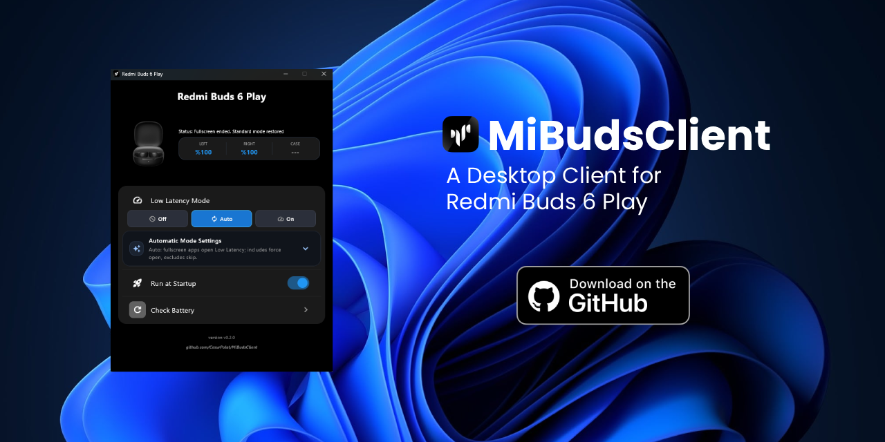

[English](../../README.md) · [Türkçe](README.tr.md) · [Deutsch](README.de.md) · [Español](README.es.md) · [Français](README.fr.md) · **Русский** · [简体中文](README.zh-CN.md)

<div align="center">


# MiBudsClient

**Ваши наушники Xiaomi и Redmi — на компьютере.**

Заряд аккумуляторов, низкая задержка, звуковые профили и сенсорное управление в одном приложении.<br>
Разработано на Python и Flet для Windows и Linux.

[**Скачать**](https://github.com/CesurPolat/MiBudsClient/releases) · [Начало работы](#начало-работы) · [Запуск из исходного кода](#запуск-из-исходного-кода) · [Сообщить о проблеме](https://github.com/CesurPolat/MiBudsClient/issues)



</div>

## Возможности

| Функция | Описание |
| --- | --- |
| Заряд аккумуляторов | Отдельные показания для левого и правого наушников и футляра, индикаторы зарядки и ручное обновление. |
| Низкая задержка | Выключение, включение или автоматическое переключение игрового режима в зависимости от активного приложения. |
| Звуковые профили | Чтение и переключение предустановок EQ, доступных на наушниках. |
| Сенсорное управление | Чтение и изменение действий для одиночного, двойного, тройного касания и долгого нажатия отдельно для каждого наушника. |
| Уведомления | Подключение, отключение и изменения положения в футляре; заряд и изображение устройства, если доступны. |
| Системный трей | Работа в фоне, восстановление окна и переключение режима задержки. |
| Повседневное использование | Автоматические попытки подключения, автозапуск, сохранение настроек и проверка обновлений. |
| Языки | 27 региональных вариантов для 24 языков, мгновенное переключение и интерфейс справа налево для арабского. |

## Совместимость

**Поддерживаемое устройство — Redmi Buds 6 Play.** Каталог Xiaomi/Redmi также содержит названия, изображения и сведения о возможностях других моделей. Наличие модели в каталоге не означает поддержку управления ею.

Windows и Linux используют собственные способы обнаружения Bluetooth-устройств. В Linux работа трея и уведомлений зависит от окружения рабочего стола. Автоматическое определение полноэкранных приложений использует инструменты X11 и недоступно в Wayland. Проверка оборудования и интерфейса в Linux ещё не завершена.

MiBudsClient — независимый проект сообщества, не связанный с Xiaomi.

## Начало работы

1. Выполните сопряжение и подключите наушники в настройках Bluetooth компьютера.
2. Загрузите сборку для своей платформы из [Releases](https://github.com/CesurPolat/MiBudsClient/releases) или [запустите из исходного кода](#запуск-из-исходного-кода).
3. Откройте приложение. Оно ищет подключённые устройства из каталога и автоматически пытается установить управляющее Bluetooth-соединение.
4. Проверьте заряд и выберите режим задержки. Откройте **Настройки** для жестов, EQ, автозапуска и языка.

Сопряжением управляет операционная система; приложению необходимо уже установленное Bluetooth-соединение. Одновременно работает только один экземпляр. Повторный запуск выводит существующее окно на передний план. Для полного закрытия используйте команду выхода в трее.

## Использование

### Низкая задержка

- **Выкл.:** стандартный режим.
- **Вкл.:** включение низкой задержки вручную.
- **Авто:** включение для полноэкранных приложений. **Включить в список** активирует режим и без полного экрана; **Исключить** пропускает приложение.

Параметр **Ждать закрытия приложения** сохраняет низкую задержку до завершения обнаруженного приложения. Правила для Windows и Linux сохраняются отдельно.

### Эквалайзер

Откройте **Настройки → Эквалайзер**, чтобы прочитать текущий профиль и предустановки. Изменения профиля подтверждаются наушниками и проверяются повторным чтением.

Редактор пользовательской кривой появляется только при получении корректных данных о полосах. Отпускание ползунка отправляет предварительный вариант; сохранение записывает кривую, сброс запрашивает ровную характеристику. После ошибки или для повторного чтения закройте и снова откройте раздел.

Переключение предустановок проверено на Redmi Buds 6 Play **2026-10-27**. Проверенное устройство не вернуло пользовательские полосы, поэтому предварительное применение, сохранение и сброс пользовательского EQ на оборудовании не подтверждены. См. [технические заметки об EQ](../equalizer.md) (на английском).

### Сенсорные жесты

Откройте **Настройки → Жесты**, чтобы загрузить назначения. Левый и правый наушники настраиваются отдельно; варианты берутся из точной записи модели в каталоге. Изменение отправляется сразу и отмечается как сохранённое только после проверки повторным чтением. Назначения хранятся в наушниках. Редактирование цикла режимов ANC не предусмотрено.

Чтение и запись прежних значений проверены **2026-10-26**. Назначение другой функции и её физический вызов жестом ещё требуют ручной проверки.

### Уведомления и язык

Уведомления содержат заряд, если данные доступны. Помещение в футляр и извлечение определяются по флагу зарядки; отдельный датчик футляра или ношения не считывается. При отключении используются последние известные показания.

Нажатие на уведомление восстанавливает окно. В Linux сервер уведомлений должен поддерживать действия по умолчанию. Системные звуки уведомлений подавляются. Приложение воспроизводит собственные мелодии при изменении состояния зарядки и один раз при первом успешном подключении наушников в каждом сеансе работы приложения.

В **Настройки → Язык** выберите системный или конкретный язык. Выбор сохраняется и сразу применяется к интерфейсу, трею и будущим уведомлениям. Для неподдерживаемого системного языка используется английский.

Доступны: арабский, китайский (упрощённый, Тайвань, Гонконг), нидерландский, английский, эстонский, финский, французский, немецкий, хинди, венгерский, индонезийский, итальянский, японский, корейский, малайский, польский, португальский (Бразилия и Португалия), русский, испанский, шведский, тайский, турецкий, украинский и вьетнамский.

## Запуск из исходного кода

Нужны Python с `venv` и `pip`, Bluetooth-адаптер и наушники, уже подключённые через операционную систему.

```sh
git clone https://github.com/CesurPolat/MiBudsClient.git
cd MiBudsClient
```

**Windows — PowerShell**

```powershell
python -m venv .venv
.\.venv\Scripts\python.exe -m pip install -r requirements.txt
.\.venv\Scripts\python.exe main.py
```

**Linux**

```sh
python3 -m venv .venv
.venv/bin/python -m pip install -r requirements.txt
.venv/bin/python main.py
```

В Linux для обнаружения нужен `bluetoothctl` из BlueZ, для трея — PyGObject (`gi`) с AppIndicator3 или GTK. Определение полного экрана в X11 также требует `xprop`, `xwininfo` и `xrandr`. Это системные зависимости; `requirements.txt` устанавливает только пакеты Python.

## Решение проблем

| Проблема | Что проверить |
| --- | --- |
| Наушники не найдены | Включите Bluetooth, проверьте соединение в системных настройках и повторите попытку. |
| Истекло время ожидания | Держите включённые наушники рядом. Выключите Bluetooth компьютера, подождите 10 секунд и включите. При необходимости положите оба наушника в футляр, закройте крышку на 5 секунд, затем извлеките и повторите попытку. |
| Нет данных о заряде | После подключения запросите заряд вручную. Отсутствующие данные считаются неизвестными. |
| Ошибка жестов или EQ | Закройте и снова откройте раздел для чтения состояния устройства. |
| Нет пользовательского EQ | Нужны корректные данные о полосах; проверенное устройство их не предоставило. Предустановки могут оставаться доступными. |
| Автоматический режим не работает в Linux | Проверьте сеанс X11 и указанные инструменты. Определение в Wayland недоступно. |
| Нажатие на уведомление Linux не работает | Проверьте поддержку действий по умолчанию или откройте окно через трей. |

В [сообщении о проблеме](https://github.com/CesurPolat/MiBudsClient/issues) укажите версию приложения, ОС и сеанс рабочего стола, модель, шаги воспроизведения и подробности ошибки.

## Разработка

`main.py` запускает и связывает компоненты. `controllers/` содержит Bluetooth, состояние устройства, логику задержки и настроек; `ui/` — интерфейс Flet, трей и уведомления; `utils/` — платформенные утилиты. Ресурсы находятся в `assets/`, тесты — в `tests/`, документация — в `docs/`.

Запускайте тесты из корня репозитория в среде разработки:

```sh
python -m unittest discover -s tests
```

Изменения протокола и констант также требуют проверки с настоящими Redmi Buds 6 Play. Синтетические тесты не доказывают совместимость. Перед изменением поведения устройства или упаковки прочитайте [AGENTS.md](../../AGENTS.md).

Переводы интерфейса находятся в `assets/locales/`. Ключи, подстановки и ресурсы Xiaomi описаны в [руководстве по локализации](../localization.md) (на английском). При изменении функций или установки обновляйте `docs/readme/` вместе с английским README.

### Сборка исполняемого файла

В активной среде должна быть доступна Flet CLI. Выполните на целевой платформе:

**Windows — PowerShell**

```powershell
flet pack main.py --icon assets\icon.ico --add-data "assets:assets" --name "MiBudsClient"
```

**Linux**

```sh
flet pack main.py --icon assets/icon.ico --add-data "assets:assets" --name "MiBudsClient" --hidden-import optparse
```

Храните ресурсы интерфейса в `assets/`, чтобы включить их в сборку. Перед выпуском проверьте файл с наушниками и запустите его дважды: второй экземпляр должен активировать существующее окно и завершиться без сообщений.

## Лицензия

MiBudsClient распространяется по [GNU General Public License v3.0](../../LICENSE).
